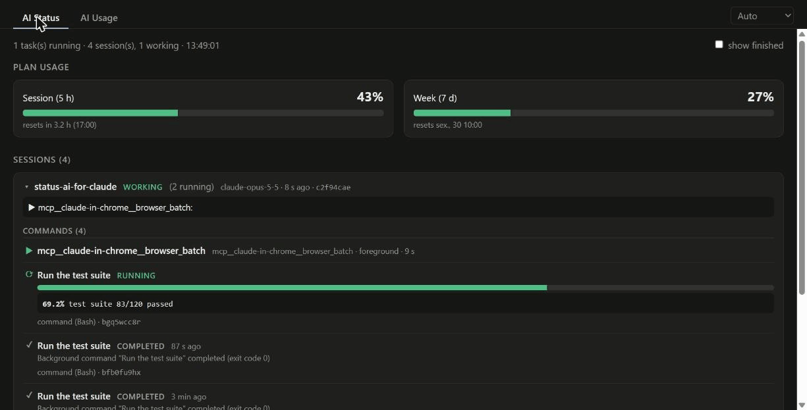
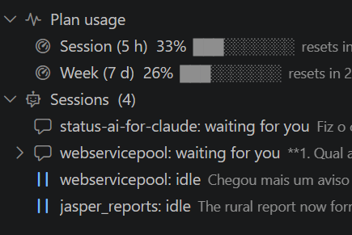
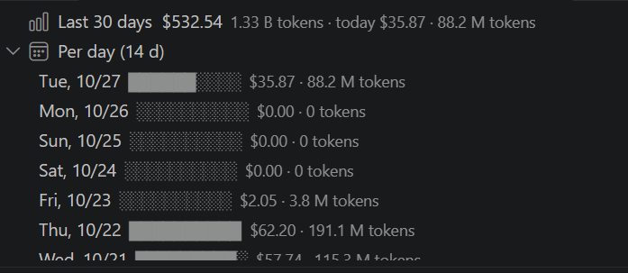
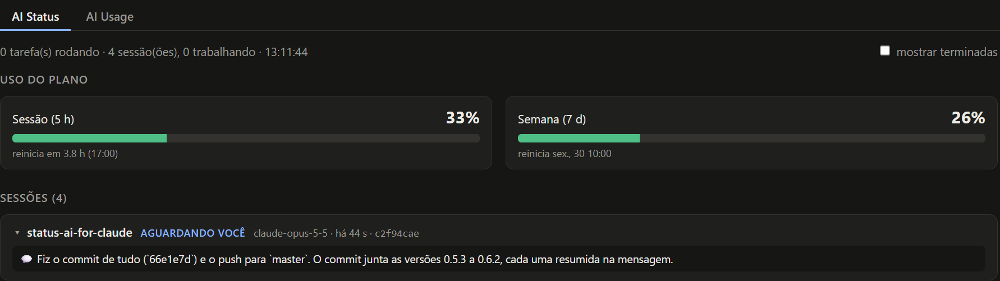
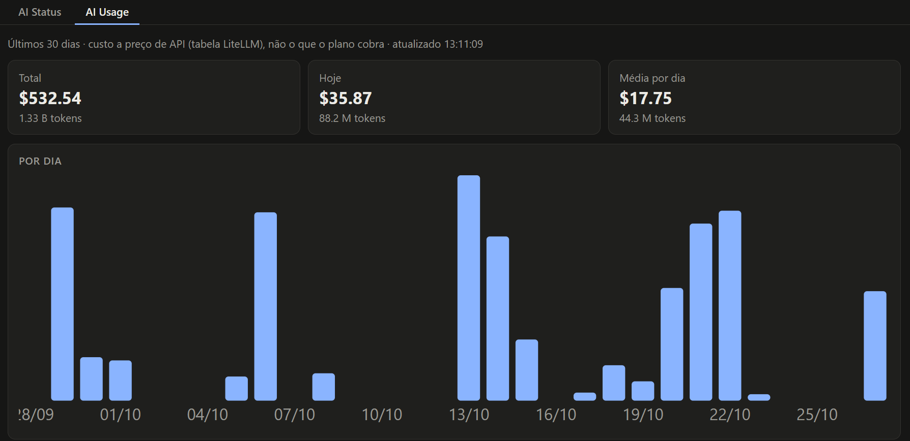

# Status AI for Claude

> **Unofficial.** Not made by, affiliated with or endorsed by Anthropic. "Claude" and "Claude Code" are trademarks of Anthropic.

See how much of your Claude Code 5-hour and weekly limits is left, and what every session, command and subagent is running, without leaving VS Code. Nothing to install: it runs on the Node.js that comes with VS Code.



A VS Code panel that shows your **plan usage** at the top (current 5-hour session and current week, with the time each resets). Below it is every Claude Code session active in the last 24 hours. Each session shows:

- its status, model and how many tasks it has running;
- what it is doing right now (the tool it is running, or the start of its last reply) and the last request you made;
- what it is running, in two groups, **Commands** (commands and other tools) and **Agents** (subagents):
  - the tool call it is waiting on right now, shown as *foreground* with how long it has been running;
  - the commands it launched in the background, with their status (running, completed, failed, killed or stopped), progress and the last line they wrote.

A finished task stays listed for 5 minutes after it ends, then leaves the list. Tasks whose session has closed are under **Inactive sessions**.

**Open in Browser** opens the same structure as a page, with two tabs, **AI Status** and **AI Usage**. The page adds the full command, the last lines of its log and a **show finished** switch that keeps every finished task listed.

| Panel: AI Status | Panel: AI Usage |
|---|---|
|  |  |





## Languages

English and Portuguese (Brazil). Any other language falls back to English.

**Choosing the language**

- **Panel, commands and settings** follow VS Code's display language. To change it, run **Configure Display Language** from the Command Palette, pick a language and restart VS Code. Portuguese needs the *Portuguese (Brazil) Language Pack*, which VS Code offers to install. To force a language without changing VS Code's, start it with `code --locale=pt-br` or `code --locale=en`.
- **Browser page** (**Open in Browser** and **Open Charts**) opens in VS Code's display language. To change it, use the language selector at the right of the tabs (**Auto**, **English**, **Português**). The browser remembers the choice for both tabs. On **Auto**, the page follows the `?lang=` in its address (the extension adds VS Code's language there), or, without it, the browser's preferred language. It is in Portuguese when that language starts with `pt`, otherwise in English.

**Adding a language**

The English text lives in the code. Each translation is a file named after the VS Code language id, for example `es` or `fr`:

1. Copy `package.nls.pt-br.json` to `package.nls.<id>.json` and translate the values. It holds the command titles and setting descriptions.
2. Copy `l10n/bundle.l10n.pt-br.json` to `l10n/bundle.l10n.<id>.json` and translate the values. It holds the panel text. Keep the keys and placeholders such as `{0}` as they are.
3. For the browser page, add the language to the script in `media/pages/head.html`, plus the `T(en, pt)` calls and `data-pt` attributes in the other files of `media/pages`. Today they hold only English and Portuguese.

## AI Usage

A second tab, **AI Usage**, sums the tokens of every model response in your Claude Code histories (sessions and subagents) over the last 30 days (`aiStatus.usageDays`) and shows them per day, project, model, token type (input, output, cache write, cache read) and tool (number of calls). **AI Usage: Open Charts** opens the same data as charts inside VS Code.

The cost is the tokens times the API prices in [LiteLLM's price table](https://github.com/BerriAI/litellm/blob/main/model_prices_and_context_window.json), the same source ccusage uses, including 1-hour cache writes and fast mode. It is what the usage would cost on the API, not what a Pro/Max plan charges. Offline, the tab shows tokens only. A response the history repeats (one line per content block, or a resumed session) counts once.

## Where the progress comes from

- **Logs.** When a command redirects its output (`> file`, `>> file`, `tee file`), the panel reads that file. The progress is the last `N/M` or `NN%` written there, for example `tile 18/93`.
- **Downloads.** When a command downloads with `curl -o` or `wget -O`, the panel compares the size of the file on disk with the size the server reports.

## Plan usage (5 h / 7 d)

Every 5 minutes the panel asks Claude Code for your plan's limits, using the same `get_usage` request that feeds Claude Code's own **Usage** view: it starts `claude` with no prompt, sends that one request and closes it. Nothing goes to the model (cost 0, no tokens), and Claude Code handles the login itself; the panel never reads your credentials. It needs the `claude` command installed and logged in.

As a fallback (or for updates after every response in the terminal), `media/statusline.js` can be Claude Code's status line. It saves the numbers it receives and prints `5h 6% · 7d 27%`:

```json
"statusLine": { "type": "command", "command": "node \"<extension folder>/media/statusline.js\"" }
```

The newest of the two wins. A window that has already reset shows no number until fresh data arrives.

## Requirements

- Nothing to install. The panel server runs on the Node.js that comes with VS Code and uses only its standard library.
- Claude Code, which writes the session histories the panel reads from `~/.claude/projects`, or from `CLAUDE_CONFIG_DIR` when that is set.

## Usage

Open the **AI Status** tab in the bottom panel, next to Terminal and Output. The panel refreshes every 3 seconds. If it gets stuck, run **AI Status: Refresh**.

## Privacy

Everything stays on your machine. The panel only **reads**:

- the Claude Code session histories;
- the output files of background tasks;
- the log files those commands write.

It serves the page on `127.0.0.1` only. It makes two kinds of network request: a `HEAD` request to the URL of a download that is in progress, to learn the file's total size, and one download of LiteLLM's public price table (from GitHub) for the AI Usage cost. Nothing about your usage is sent.

## Settings

| Setting | Default | |
|---|---|---|
| `aiStatus.port` | `8765` | Local port of the panel server |
| `aiStatus.days` | `3` | Days of sessions to scan for tasks |
| `aiStatus.usageDays` | `30` | Days of history the AI Usage tab sums |
